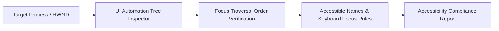

<p align="center"><a href="https://kitsunetechnologies.org/work"></a></p>

# Focus Check

Read-only Windows accessibility checker. Inspects keyboard focus, UI Automation tree order, and focus visibility without activating windows or sending input.

[](https://github.com/KitsuneTech1/accessibility-verifier/actions)
[](LICENSE) 

## Quick Start

Install Python 3.8 or newer. The tool has no required dependencies, but optional `comtypes` (pip install comtypes) enables UI Automation inspection.

Run a check and write an HTML report:

```bash
python accessibility_verifier.py "Window Title"
```

The report and a PNG snapshot (if available) are written to the current directory.

For options and examples:

```bash
python accessibility_verifier.py --help
```

## What it checks

When optional UI Automation support is available, the tool reports:

- Enabled interactive controls that UI Automation marks keyboard-focusable.
- Enabled interactive controls that UI Automation does not mark keyboard-focusable.
- Focusable controls in UI Automation tree order.
- UI Automation descendants that currently report keyboard focus.
- A snapshot captured by an external read-only snapshot command.
- An HTML report or a JSON report.

The focus order result is the observed UI Automation tree order. It is not a simulated Tab or Shift+Tab run. Tab traps are not tested because the tool never sends input. A screenshot cannot prove that a focus indicator is visible, so the HTML report marks visible focus for manual review.

## Requirements

- Windows for real window and UI Automation inspection.
- Python 3.8 or newer.
- Optional `comtypes` installation for UI Automation access. Without it, the tool still produces a report with a clear unavailable-support warning.
- An external read-only snapshot command that accepts the arguments `--window WINDOW --output PATH`. The default command name is `snap.exe`, but use `--snap` to provide another command.

The repository has no required third-party Python dependencies. It does not bundle `comtypes` or a snapshot command.


## Architecture & Data Flow



## Usage

Run a check and write an HTML report. A PNG is written beside it when the snapshot command succeeds:

```bash
python accessibility_verifier.py "Window Title"
```

Options:

- `--output PATH` sets the HTML report path. The default is `accessibility_report.html`.
- `--snapshot-output PATH` sets the PNG path. The default uses the report name with a `.png` suffix.
- `--snap COMMAND` sets the snapshot command. The default is `snap.exe`.
- `--json` prints the combined report as JSON to standard output. Progress is written to standard error.

Examples:

```bash
python accessibility_verifier.py "Notepad" --output notepad.html
python accessibility_verifier.py "My App" --snap C:\tools\snap.exe
python accessibility_verifier.py "My App" --json > report.json
```

If the exact window title is not found, or optional UI Automation or snapshot support is unavailable, the command returns a report containing warnings. It does not try to repair or control the target application.

## Python API

```python
from accessibility_verifier import (
    analyze_keyboard_reachability,
    analyze_focus_order,
    analyze_visible_focus,
    generate_html_report,
)

window = "My App"
keyboard = analyze_keyboard_reachability(window)
focus_order = analyze_focus_order(window)
visible_focus = analyze_visible_focus(window, snapshot_path="my_app.png")

generate_html_report(
    window,
    keyboard,
    focus_order,
    visible_focus,
    "my_app_accessibility.html",
)
```

## Manual review

Use the saved snapshot and the report to check:

- Whether the current focus has a visible outline, highlight, or other change.
- Whether the reported tree order matches the intended visual order.
- Whether every interactive control can be reached with Tab and Shift+Tab.
- Whether keyboard-only operation works throughout the application.
- Whether a real keyboard test reveals a focus trap.

## Limitations

This is a read-only inspection tool, not a complete accessibility audit. It does not simulate input, inspect screen-reader output, infer visual focus from pixels, or guarantee the framework's actual Tab order. Use a real keyboard and assistive technology for those checks. Useful complementary tools include NVDA, JAWS, and Microsoft's Inspect tool.

## Testing

Tests use only the Python standard library and do not open windows, send input, or make network calls.

```bash
pytest tests/ -v
```

Or with unittest:

```bash
python -m unittest discover -s tests -v
```

## License

MIT. Copyright (c) 2026 Kitsune Technologies LLC. Do what you like with it, commercially or otherwise, just keep the copyright notice. Full text in [LICENSE](LICENSE).

---

<p align="center"><sub>Part of <b>Buildtober 2026</b>: 31 open source projects in 31 days. Built by <a href="https://kitsunetechnologies.org/work">Kitsune Technologies</a>. More at <a href="https://github.com/KitsuneTech1">github.com/KitsuneTech1</a>.</sub></p>
